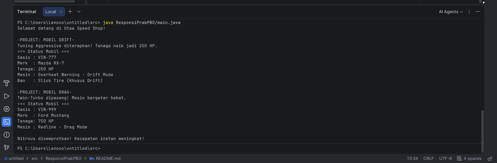

Responsi Akhir Praktikum Pemrograman Berorientasi Objek
[A.] Identitas Mahasiswa dan Tema
1. Nama :        Sulthan Ahmad Muthi A.K.A Utaaa
2. NIM :         H1D025159
3. Tema Sistem : Otomotif (Sistem Garasi Kustomisasi Mobil)

[B.] Petunjuk Compile dan Run (Melalui Terminal)
Pastikan terminal dibuka dari dalam folder `src`.

1. Compile semua file dengan perintah:
   javac ResponsiPrakPBO/*.java

2. Jalankan program dengan perintah:
   java ResponsiPrakPBO/Main.java

[C.] Output program
1. 
